# JurisGuard Entity-Relationship Diagram (ERD)

Aligned 1:1 with [`backend/models.py`](../backend/models.py), [`JurisGuard_ERD_schema.sql`](../JurisGuard_ERD_schema.sql), and [`JurisGuard ERD - updated.json`](../JurisGuard%20ERD%20-%20updated.json) (**31 tables**, **49 foreign-key relationships**).

```mermaid
erDiagram
    role ||--o{ user : "assigns"
    user ||--o{ revoked_access_token : "revokes"
    user ||--o{ user_presence : "tracks"
    user ||--o{ client : "created_by_user_id"
    user ||--o{ intake_record : "interviewer_id"
    user ||--o{ case : "terminated_by"
    user ||--o{ case_history : "updated_by"
    user ||--o{ document : "uploaded_by"
    user ||--o{ extracted_metadata : "verified_by"
    user ||--o{ reviewed_paper_intake : "reviewed_by"
    user ||--o{ audit_log : "logs"
    user ||--o{ case_submission : "staff_id / reviewed_by"
    user ||--o{ submission_feedback : "reviewer_id"
    user ||--o{ case_transfer_report : "from / to / initiated_by"
    user ||--o{ notification : "receives"
    user ||--o{ private_message : "sender / recipient"
    user ||--o{ private_message_reaction : "reacts"
    user ||--o{ reminder : "created_by_user_id"

    client ||--|| client_details : "has details"
    client ||--|| client_classification : "has classification"
    client ||--o| reviewed_paper_intake : "has reviewed paper intake"
    client ||--o{ intake_record : "submits"
    client ||--o{ case : "primary client"
    client ||--o{ case_client : "participates in"

    intake_record ||--o{ case : "originates"
    intake_record ||--o{ representative : "lists"
    intake_record ||--o{ adverse_party : "lists"
    intake_record ||--o{ document : "attaches"

    case_nature ||--o{ case : "classifies"
    court_branch ||--o{ case : "assigns"
    case ||--o{ case_client : "includes participants"
    case ||--o{ case_history : "records history"
    case ||--o{ document : "attaches"
    case ||--o{ case_submission_item : "included in submission"
    case ||--o{ case_transfer_item : "included in transfer"

    document ||--o{ extracted_metadata : "extracts"
    document ||--o{ paper_extraction_draft : "drafts OCR"
    document ||--o| reviewed_paper_intake : "persists review"

    case_submission ||--o{ case_submission : "parent_submission_id"
    case_submission ||--o{ case_submission_item : "contains"
    case_submission ||--o{ submission_feedback : "receives feedback"

    case_transfer_report ||--o{ case_transfer_report : "parent_report_id"
    case_transfer_report ||--o{ case_transfer_item : "contains cases"
    case_transfer_report ||--o{ case_transfer_administrative_entry : "contains admin rows"

    private_message ||--o{ private_message_reaction : "has reactions"

    role {
        int role_id PK
        string role_name
        text permissions
    }

    user {
        int user_id PK
        int role_id FK
        string username UK
        string password_hash
        boolean mfa_enabled
        string mfa_secret
        datetime created_at
        string email
        string full_name
        string approval_status
        boolean is_active
        datetime last_login_at
        text profile_image_path
        text profile_picture_path
        boolean profile_completed
        string first_name
        string middle_name
        string last_name
        string suffix
        string mobile_number
        text address
        string sex
        string birth_date
    }

    revoked_access_token {
        string token_hash PK
        int user_id FK
        datetime expires_at
    }

    user_presence {
        string token_hash PK
        int user_id FK
        datetime last_seen_at
        datetime last_interaction_at
        datetime expires_at
    }

    client {
        int client_id PK
        int created_by_user_id FK
        text name
        int age
        string sex
        string civil_status
        string religion
        string educational_attainment
        string citizenship
        string language_dialect
        datetime created_at
        datetime deleted_at
    }

    client_details {
        int details_id PK
        int client_id FK
        text address
        text contact_no
        text email
        text individual_monthly_income
        text spouse
        text address_of_spouse
        text contact_no_of_spouse
        text representative_name
        int representative_age
        string representative_sex
        string representative_civil_status
        text representative_address
        text representative_contact_no
        string representative_relationship
        text representative_email
        boolean detained
        datetime detained_since
        string place_of_detention
    }

    client_classification {
        int classification_id PK
        int client_id FK
        boolean class_cicl
        boolean class_woman
        boolean class_law_enforcer
        boolean class_tenant_agrarian
        boolean class_ofw_land
        boolean class_ofw_sea
        boolean class_former_rebel
        boolean class_trafficking_victim
        boolean class_senior_citizen
        boolean class_vawc_victim
        boolean class_drug_related
        boolean class_terrorism_arrested
        boolean class_torture_victim
        boolean class_voluntary_rehab
        string class_foreign_national
        string class_refugee
        string class_urban_poor
        string class_rural_poor
        string class_indigenous_people
        string class_pwd_type
        boolean class_urban
        boolean class_rural
        boolean class_9165
        boolean class_female
        boolean flags_reviewed
        text classification_notes
    }

    intake_record {
        int intake_id PK
        int client_id FK
        int interviewer_id FK
        string control_no UK
        datetime form_date
        string region
        string district_office
        string party_represented
        string applicant_role
        string applicant_role_other
        text nature_of_request
        string nature_of_case
        boolean coi_agree_different_office
        boolean coi_agree_same_dept_appeal
        boolean coi_waive_right_to_complain
        boolean coi_trust_assigned_counsel
        datetime proof_submission_deadline
        boolean proof_submission_satisfied
        boolean proof_itr_satisfied
        datetime proof_itr_date
        boolean proof_brgy_satisfied
        datetime proof_brgy_date
        boolean proof_dswd_satisfied
        datetime proof_dswd_date
        boolean proof_others_satisfied
        text proof_others_details
        datetime proof_others_date
        boolean inv_plaintiff
        boolean inv_defendant
        boolean inv_oppositor
        boolean inv_petitioner
        boolean inv_respondent
        boolean inv_complainant
        boolean inv_accused
        text inv_others
    }

    case_nature {
        int nature_id PK
        string nature_name
    }

    court_branch {
        int branch_id PK
        string branch_name
    }

    case {
        int case_id PK
        int intake_id FK
        int client_id FK
        int nature_id FK
        int branch_id FK
        string case_type
        string title_of_case
        string case_no
        string court_body
        string status_of_case
        string case_status
        string incident_barangay
        string incident_city
        text incident_address
        string latitude
        string longitude
        text last_action_taken
        boolean detained
        datetime date_of_confinement
        string place_of_detention
        string location_type
        text cause_of_action
        text facts_of_case
        boolean pending_in_court
        datetime date_of_termination
        text cause_of_termination
        string assigned_pao
        string hearing_schedule
        text remarks
        datetime terminated_at
        text termination_reason
        text termination_remarks
        string resolution_type
        int terminated_by FK
        string handled_by
        text supporting_document_path
        boolean is_terminated
        datetime last_updated
    }

    case_client {
        int case_client_id PK
        int case_id FK
        int client_id FK
        string party_represented
        string applicant_role
        string applicant_role_other
        text representative_name
        int representative_age
        string representative_sex
        string representative_civil_status
        text representative_address
        string representative_contact_no
        string representative_relationship
        text representative_email
        datetime created_at
    }

    case_history {
        int history_id PK
        int case_id FK
        int updated_by FK
        string previous_status
        string new_status
        text action_taken
        text remarks
        datetime created_at
    }

    representative {
        int rep_id PK
        int intake_id FK
        text rep_name
        int rep_age
        string rep_sex
        string civil_status
        text rep_address
        text rep_contact_no
        string relationship_to_applicant
    }

    adverse_party {
        int adverse_id PK
        int intake_id FK
        boolean role_plaintiff_complainant
        boolean role_defendant_respondent_accused
        boolean role_oppositor_others
        text name
        text address
    }

    document {
        int document_id PK
        int case_id FK
        int intake_id FK
        int uploaded_by FK
        string document_type
        text encrypted_file_path
        string ocr_status
        datetime uploaded_at
    }

    extracted_metadata {
        int meta_id PK
        int document_id FK
        int verified_by FK
        jsonb extracted_json
        string verification_status
        datetime verified_at
    }

    paper_extraction_draft {
        string draft_id PK
        int document_id FK
        jsonb extraction_json
    }

    reviewed_paper_intake {
        int id PK
        int client_id FK_UK
        int document_id FK_UK
        int reviewed_by FK
        datetime reviewed_at
        jsonb sections
        jsonb unreadable_fields
        jsonb field_reviews
        jsonb checkbox_states
        string source_draft_id
        jsonb candidate_snapshot
    }

    audit_log {
        int log_id PK
        int user_id FK
        string action
        string target_entity
        datetime timestamp
        string ip_address
        text description
        string entity_id
        string extraction_mode
        text fallback_reason
        text previous_hash
        text current_hash
    }

    case_submission {
        int submission_id PK
        int parent_submission_id FK
        int staff_id FK
        text title
        datetime date_from
        datetime date_to
        string status
        int version
        text notes
        datetime submitted_at
        datetime approved_at
        int reviewed_by FK
        datetime created_at
        datetime updated_at
    }

    case_submission_item {
        int submission_item_id PK
        int submission_id FK
        int case_id FK
        jsonb snapshot_json
    }

    submission_feedback {
        int feedback_id PK
        int submission_id FK
        int reviewer_id FK
        text comments
        datetime created_at
    }

    case_transfer_report {
        int report_id PK
        int parent_report_id FK
        int from_user_id FK
        int to_user_id FK
        int initiated_by_user_id FK
        text title
        datetime report_date
        datetime date_received
        string status
        text remarks
        datetime submitted_at
        datetime returned_at
        datetime confirmed_at
        int version
        datetime created_at
        datetime updated_at
    }

    case_transfer_item {
        int item_id PK
        int report_id FK
        int case_id FK
        string section
        jsonb snapshot_json
    }

    case_transfer_administrative_entry {
        int entry_id PK
        int report_id FK
        string section
        int row_number
        string control_no
        text title_of_case
        string docket_no
        datetime date_received
        string status_of_case
        text cause_of_action
    }

    notification {
        int notification_id PK
        int user_id FK
        string event_key
        string notification_type
        string title
        text message
        text redirect_to
        string entity_type
        string entity_id
        boolean is_read
        datetime created_at
    }

    private_message {
        int message_id PK
        int sender_user_id FK
        int recipient_user_id FK
        text content
        datetime created_at
        datetime read_at
    }

    private_message_reaction {
        int reaction_id PK
        int message_id FK
        int user_id FK
        string emoji
    }

    reminder {
        int reminder_id PK
        int created_by_user_id FK
        string title
        text description
        date reminder_date
        time start_time
        time end_time
        string category
        string priority
        string visibility
        int notification_minutes_before
        string status
        datetime created_at
        datetime updated_at
    }

    calendar_holiday {
        int holiday_id PK
        string source_key UK
        string name
        date holiday_date
        string classification
        string coverage
        string geographic_scope
        string reference
        text source_url
        int year
        datetime updated_at
    }
```

